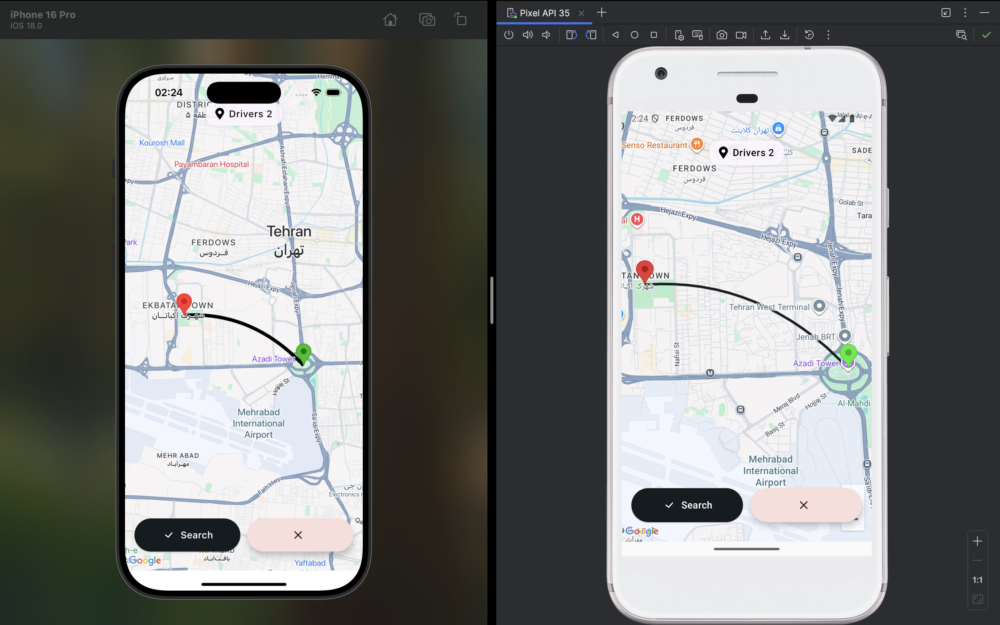
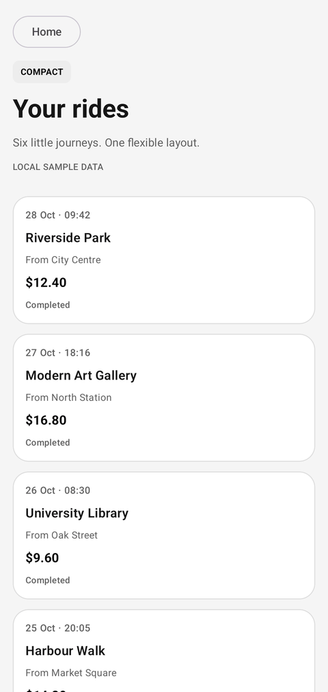
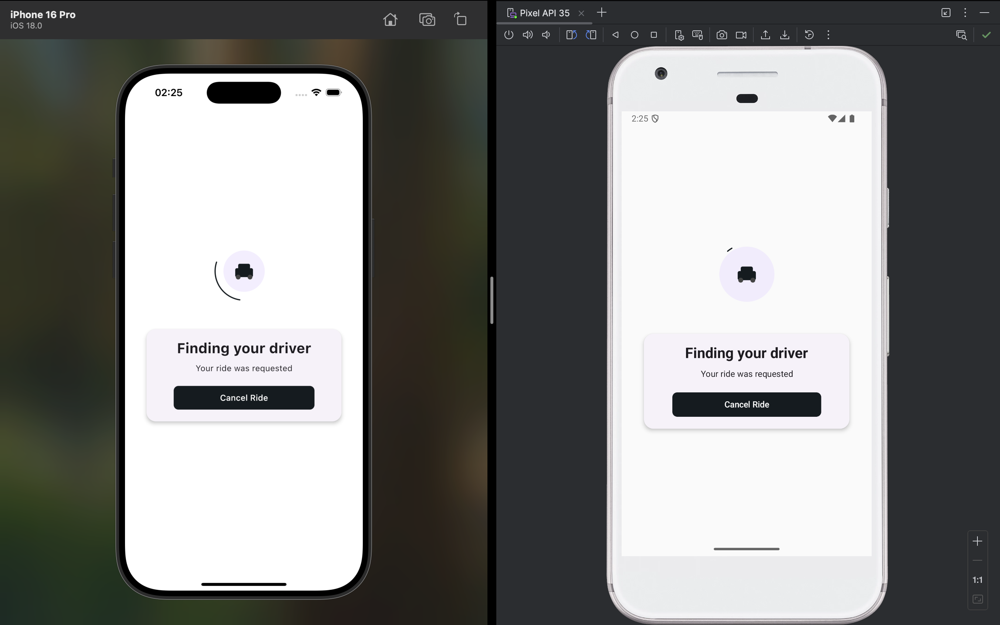
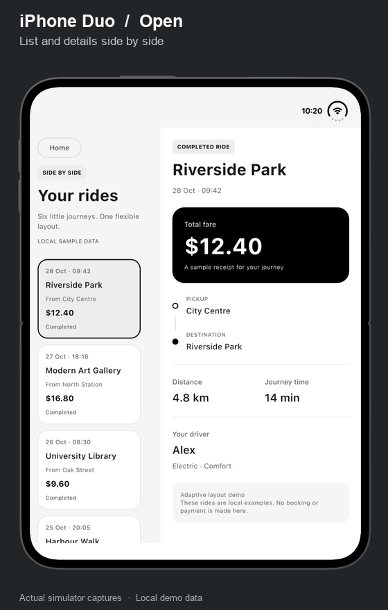
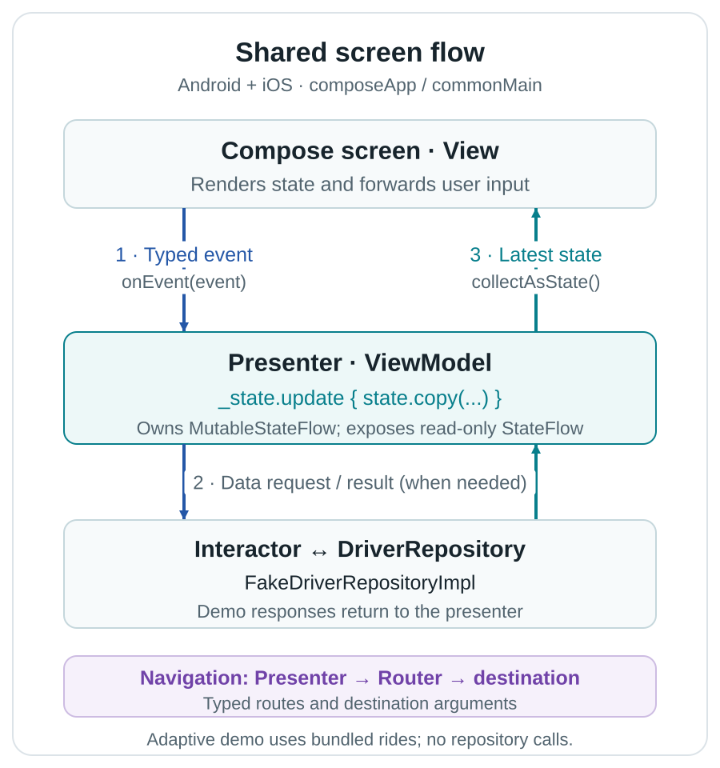
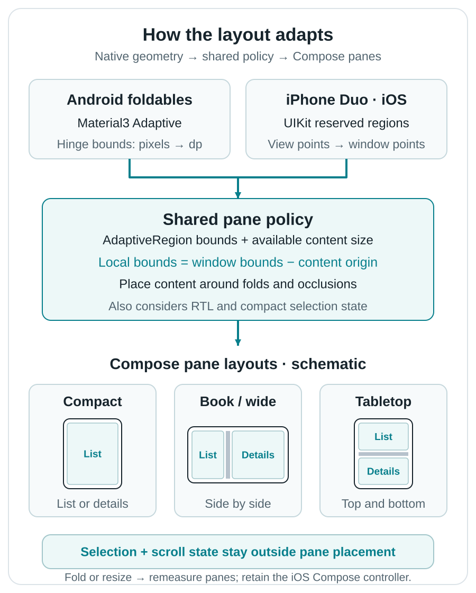

[Part 1 — KMP and VIPER Architecture](https://medium.com/@mahdizareeii/building-a-mini-uber-with-kotlin-multiplatform-viper-architecture-compose-multiplatform-1d3dd0a08399) · [Part 2 — Adaptive iPhone Duo UI](https://medium.com/@mahdizareeii/mini-uber-part-2-building-an-adaptive-iphone-duo-ui-with-compose-multiplatform-70fde9189685)

# Mini-Uber — Adaptive Compose Multiplatform with VIPER Architecture

| Original map experience | Adaptive Compose demo |
| :---: | :---: |
| **Map selection · Android and iOS**<br>[](Screenshot_1.png) | **Android · Pixel Fold**<br>[](artifacts/adaptive-demo/android-adaptive.gif) |
| **Ride request · Android and iOS**<br>[](Screenshot_2.png) | **iOS · iPhone Duo in Device Hub**<br>[](artifacts/adaptive-demo/ios-adaptive.gif) |

Mini-Uber is an Android and iOS example of shared UI, presenter state, and navigation using **Kotlin Multiplatform (KMP)**, **Compose Multiplatform (CMP)**, and **VIPER architecture**. Home opens the original map flow or an independent adaptive ride-history demo. The map uses a fake repository; the adaptive demo reads six bundled sample rides.

## Technology and KMP structure

| Technology | Responsibility in this project |
| --- | --- |
| Kotlin Multiplatform | Shares presentation, domain models, repository contracts, and layout policy in `commonMain`; supplies native implementations through `expect`/`actual`. |
| Compose Multiplatform + Material3 | Shares declarative screens, theme, components, resources, and animations across Android and iOS. |
| Coroutines + StateFlow | Runs asynchronous work in presenter scopes and exposes observable screen state. |
| Koin + lifecycle ViewModel | Creates dependencies and provides a presenter for each navigation destination. |
| Navigation Compose + Kotlin Serialization | Defines typed routes and decodes destination arguments through `SavedStateHandle`. |
| Material3 Adaptive + UIKit | Supplies platform fold and occlusion information to the shared pane policy. |
| Maps Compose + Google Maps iOS | Implements the native map behind a shared Compose contract. |

[`composeApp`](composeApp/build.gradle.kts) is the KMP library. Shared Kotlin compiles to JVM bytecode for Android and native code for iOS. [`androidApp`](androidApp/build.gradle.kts) consumes the Android target. Kotlin/Native builds a static `ComposeApp` framework for physical iOS ARM64 devices and Apple Silicon simulators; [`iosApp`](iosApp/iosApp) hosts it through SwiftUI and UIKit. The feature folders are packages inside the shared library. Dependency pins are centralized in the [version catalog](gradle/libs.versions.toml).

CMP extends the Compose programming model to shared UI; native APIs remain available at platform boundaries. See the [Kotlin documentation](https://kotlinlang.org/docs/multiplatform/compose-multiplatform-and-jetpack-compose.html).

## KMP and VIPER architecture flow

The original screen → presenter → interactor → repository flow lives in shared Kotlin. **View** is a Compose screen, **Presenter** is a lifecycle ViewModel, **Interactor** exposes feature operations, **Entity** is a shared model, and **Router** owns navigation. Koin wires these dependencies. The adaptive feature reads local fixtures directly through its initial state.

[](artifacts/readme-diagrams/screen-state-flow.svg)

**Follow 1 → 2 → 3:** user input reaches the presenter, any data result updates state, and Compose renders that state. Navigation follows the separate purple path. Click the graphic to view it full size.

## How state management works

1. **Ownership:** [`BaseContract.Presenter`](composeApp/src/commonMain/kotlin/com/shared/miniuber/core/base/BaseContract.kt) creates one `MutableStateFlow(UiState(initialState))` and exposes its read-only `asStateFlow()` view. [`UiState`](composeApp/src/commonMain/kotlin/com/shared/miniuber/core/base/UiState.kt) keeps feature `data`, `isLoading`, and `error` together, allowing content to remain visible during loading or failure.
2. **Rendering and events:** a screen gets its presenter with `koinViewModel()` and observes `presenter.state.collectAsState()`. Compose reads the resulting state and recomposes when it changes. User callbacks send typed events to `onEvent`; the screen does not mutate presenter state.
3. **Updates:** presenters call `_state.update` and create new data-class copies. Previously published snapshots retain their values. StateFlow keeps the latest value and suppresses equal values; it represents current state rather than an event history. For example, [`AdaptiveDemoPresenter`](composeApp/src/commonMain/kotlin/com/shared/miniuber/feature/adaptive/AdaptiveDemoPresenter.kt) validates the ride ID, then copies `selectedRideId` into the existing feature data.
4. **Asynchronous work:** Home and Ride Request use `viewModelScope`, set loading before repository calls, and publish success or error state afterward. Clearing the ViewModel cancels its scope.
5. **Navigation:** presenters call the router directly. Ride Request's [`ScreenRouter`](composeApp/src/commonMain/kotlin/com/shared/miniuber/core/ScreenRouter.kt) decodes arguments from that destination's own `SavedStateHandle`:

```kotlin
private val argument = router.getScreenArg<AppScreens.RideRequestScreen>(
    screen = AppScreens.RideRequestScreen::class
)
```

The base also exposes one stable `SharedFlow` for UI actions. Its default `MutableSharedFlow()` has no replay or extra buffer; current feature presenters do not emit through it. It is infrastructure for transient actions, while current navigation uses the router. See the [SharedFlow semantics](https://kotlinlang.org/api/kotlinx.coroutines/kotlinx-coroutines-core/kotlinx.coroutines.flow/-shared-flow/).

In the adaptive screen, selected ride ID stays in the presenter. `rememberLazyListState()` and a `rememberSaveable` map of per-ride detail scroll states are created **outside the changing panes**. A wide layout can preview the first ride without writing a selection, so closing the device does not manufacture compact navigation intent. Selection is ViewModel memory; it is not explicitly saved for process-death restoration.

## Adaptive layouts on iPhone Duo

The iOS GIF shows **iPhone Duo in Xcode 27.1 Device Hub**. Apple documents that device and development support in its [iPhone Duo announcement](https://developer.apple.com/news/?id=kkphp5qo). This repository demonstrates simulator behavior.

[`AdaptiveHostViewController.swift`](iosApp/iosApp/AdaptiveHostViewController.swift) retains one Compose controller and one shared `AdaptiveWindowState`. Its host view reads active [`UIView.ReservedRegion`](https://developer.apple.com/documentation/uikit/uiview/reservedregion) values for `.division` and `.occlusion` inside `updateConstraints()`. UIKit tracks those reads; region, window-frame, and safe-area changes update the geometry supplied to Compose. The API is guarded by `#available(iOS 27.1, *)`; older supported versions use available window size and safe areas.

[`AdaptiveWindowState`](composeApp/src/commonMain/kotlin/com/shared/miniuber/component/adaptive/AdaptiveWindowState.kt) validates region rectangles and publishes them with `mutableStateOf`. `MainViewController` supplies that state through `LocalAdaptiveWindowState`; the iOS `actual currentAdaptiveRegions()` reads it during composition.

[](artifacts/readme-diagrams/adaptive-layout-flow.svg)

**Read top to bottom:** each platform supplies geometry, shared Kotlin calculates safe pane bounds, and Compose places the list and details. The device shapes illustrate layout rules; the GIFs above show the running app.

The main technical challenges are handled in shared code:

- **Coordinate alignment:** Swift converts view-local regions into window coordinates; Android converts window pixels into dp. Compose measures its origin after safe-area padding, and the policy subtracts that origin to produce local pane bounds. This keeps the fold aligned when content is offset.
- **Geometry-driven layout:** a spanning vertical division separates list and detail; a horizontal division puts the list above the details. Otherwise, content below **600dp** uses one pane, and wider content uses two. The list uses 35% of the width, clamped to 240–360dp.
- **Safe placement:** occluded regions are removed from usable pane space. RTL swaps pane roles while preserving physical fold coordinates. If a pane becomes unusable, compact navigation uses the surviving safe pane. Rendering rounds bounds inward and clips each pane.
- **Continuity:** native layout updates change observable regions instead of recreating the Compose controller. Selection and scroll state remain independent of pane placement.

The current iOS recording shows rotation, open, partially open/book, and closed states. Horizontal/tabletop geometry is implemented in the policy and covered by shared tests; it is not shown in this GIF.

## Source index

| Source | Start here for |
| --- | --- |
| [`App.kt`](composeApp/src/commonMain/kotlin/com/shared/miniuber/App.kt) | Shared theme, typed NavHost, and feature destinations. |
| [`core`](composeApp/src/commonMain/kotlin/com/shared/miniuber/core) | Base contracts, state, routes, and destination-scoped argument decoding. |
| [`feature`](composeApp/src/commonMain/kotlin/com/shared/miniuber/feature) | Landing, map/Home, Ride Request, and Adaptive packages, with separate screen/presenter/state/event/component files. |
| [`domain`](composeApp/src/commonMain/kotlin/com/shared/miniuber/domain) / [`data`](composeApp/src/commonMain/kotlin/com/shared/miniuber/data) | Models, interactors, repository interface, and fake implementation. |
| [`component/adaptive`](composeApp/src/commonMain/kotlin/com/shared/miniuber/component/adaptive) | Geometry models, window state, pane policy, and rendering. |
| [`androidApp`](androidApp/src/main/java/com/android/miniuber) / [`androidMain`](composeApp/src/androidMain/kotlin/com/shared/miniuber) | Android startup and platform adapters. |
| [`iosApp`](iosApp/iosApp) / [`iosMain`](composeApp/src/iosMain/kotlin/com/shared/miniuber) | SwiftUI/UIKit startup, reserved-region bridge, shared controller, and native maps. |
| [`commonTest`](composeApp/src/commonTest/kotlin/com/shared/miniuber) / [`iosTest`](composeApp/src/iosTest/kotlin/com/shared/miniuber) | State, navigation, adaptive geometry, selection, and iOS argument-decoding regressions. |
