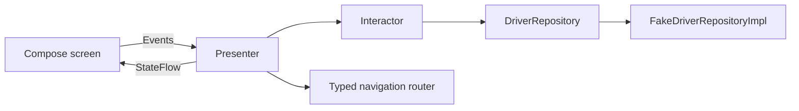

# Mini-Uber

A small Android and iOS app built with Kotlin Multiplatform, Compose Multiplatform, and a VIPER-style architecture. A shared Home screen opens either the original ride-request map experience or a separate adaptive ride-history demo. Screens and business logic are shared, with native Google Maps integration on each platform.

[Original architecture article](https://medium.com/@mahdizareeii/building-a-mini-uber-with-kotlin-multiplatform-viper-architecture-compose-multiplatform-1d3dd0a08399)

The original map flow:

| Map selection | Ride request |
| --- | --- |
|  |  |

## What the demo does

Home offers two independent destinations:

- **Map experience:** move the map and select a pickup point, then a destination, from its center. See a simulated nearby-driver count and a decorative curve, request a ride, and cancel it to return to map selection. Cancel returns to map selection through navigation; Home opens the landing screen.
- **Adaptive demo:** browse six local example rides and their read-only details. Resize, rotate, or fold the device to switch layouts while keeping the selected ride and scroll positions. This demo does not need a Maps key and does not create bookings.

The map keeps the original stateless fake repository. It generates sample driver and ride responses, reports `NoTrip`, and does not persist or cancel a booking. Its `requestedAt` field remains the original UUID placeholder, not a timestamp. Driver information is generated locally; there is no backend, GPS integration, address search, road routing, payment processing, or full assigned/arriving/completed trip flow. The adaptive demo's completed rides are separate fixtures, not persisted map bookings. Android and iOS are the configured targets; there is no desktop target.

### Adaptive behavior

The looping GIFs are exported from real recordings of the running app at 15 fps. Android preserves the native emulator's recorded inner/outer display switches; long idle pauses are trimmed. The iOS GIF uses one continuous 27.6-second segment of a native macOS recording of Xcode's Device Hub, including the actual cursor and posture-control selections. Both demos use local sample data and work without Maps credentials.

For mobile developers, the demo shows a shared Compose list/detail screen adapting to compact and two-pane layouts across rotation and folding. The selected Harbour Walk ride remains available in compact details after the iPhone closes; these are read-only sample trips, with no network or booking operation.

[Download the earlier 40-second LinkedIn showcase](artifacts/adaptive-demo/adaptive-showcase.mp4) — unchanged Android followed by iOS footage, 1080×1350, H.264 at 30 fps, without audio. This earlier MP4 retains the original iOS simulator recordings with cuts between displays; it does not include the new Device Hub window recording below.

| Android · Pixel Fold | iOS · iPhone Duo |
| --- | --- |
|  |  |
| Select a ride → open → half open/book → fully open → closed details. | Compact list → rotate → open → select rides → partially open/book → closed Harbour Walk details. |

- Below **600dp of measured content width**, the list and selected ride detail occupy separate screens. **All rides** and Android Back return from details to the list; Home returns to the landing screen.
- At **600dp and above**, list and detail appear side by side. The list uses 35% of the width, clamped to 240–360dp, with a 24dp gap. With no explicit selection, the first ride appears in the detail pane without changing compact navigation state.
- Active vertical folds split the panes at their reported bounds; horizontal folds use a tabletop layout with the list above the details. These bounds override the width breakpoint. RTL puts the side-by-side list on the right. Headers and navigation controls stay inside their panes, respect safe areas, and scroll in short windows. Occluded regions are excluded from usable pane space. If an occlusion removes a pane entirely, the remaining safe pane uses compact navigation so both the list and details stay reachable.
- Android obtains fold information through Compose Material3 Adaptive 1.3.0. On **iOS 27.1 and later**, a UIKit bridge reads active `UIView.reservedRegions` divisions and occlusions, converts them to window coordinates, and updates the shared layout. Older iOS versions use window-size adaptation and safe areas without fold-region information.

The adaptive screen targets the main app window on Fold/Flip-style devices and iPhone Duo. A dedicated Galaxy Z Flip external cover-screen experience is outside this demo's scope. The map screen retains its original layout and camera interaction.

## How it works



- **View:** shared Compose screens render immutable presenter state and send user events.
- **Presenter:** lifecycle ViewModels manage screen state, events, and navigation using the existing feature contracts.
- **Interactor:** feature interfaces expose operations backed by the repository.
- **Entity:** shared models represent locations, drivers, and ride requests.
- **Router:** presenters read typed screen arguments through the router. Koin supplies a router bound to the destination's `SavedStateHandle`.

`androidApp` contains the Android application entry point and platform configuration. `composeApp` contains the shared `core`, `data`, `domain`, `feature`, and `component` packages, shared tests, Android Maps Compose adapter, and iOS UIKit bridge. `iosApp` hosts the shared Compose controller in SwiftUI and implements the native Google Maps controller.

`feature.landing` and `feature.adaptive` follow the same structure as `feature.home` and `feature.riderequest`: each Contract, Presenter, State, Event, Action, and Screen has its own file. Screens render state and send events; presenters own navigation through the router. Individual UI components live in each feature's `component` package. The adaptive demo keeps its `DemoRide` model in `model` and its six bundled fixtures in `data`, separate from the fake ride repository. `component.adaptive` contains the shared pane layout, geometry types, and platform contracts in separate files.

Ride Request retains typed argument access inside the presenter:

```kotlin
private val argument = router.getScreenArg<AppScreens.RideRequestScreen>(
    screen = AppScreens.RideRequestScreen::class
)
```

`ScreenRouter` decodes those arguments from the presenter's own back-stack `SavedStateHandle`. They remain bound to that destination even if another screen becomes current. The screen and `App` do not unpack or pass a separate input object. The original `RideRequestScreen()` constructor and `Double.NaN` fallback are preserved. The original `isValidLocation()` comparison against `NaN` evaluates to false, so initialization follows the fake last-request path. This is retained original demo behavior, not production coordinate validation or persisted ride resumption.

The map retains continuous camera-position callbacks and the original pickup → destination → request flow. Ride business logic has been restored to the original implementation. The shared base still provides immutable `UiState` snapshots and a stable presenter action stream; the separate Home and adaptive screens use that same base pattern.

## Toolchain and dependencies

Exact Android/shared dependency versions are maintained in [`gradle/libs.versions.toml`](gradle/libs.versions.toml). The project also pins Gradle through its wrapper and Google Maps through an iOS Swift package resolution file.

| Component | Version |
| --- | --- |
| Android Studio | Rabbit 2 / 2026.2.2 |
| Android Gradle Plugin / Gradle | 9.5.0 / 9.8.2 |
| Kotlin and compiler plugins | 2.4.21 |
| Compose Multiplatform / Material3 | 1.12.2 / 1.9.0 |
| Compose Material3 Adaptive | 1.3.0 |
| JetBrains Lifecycle / Navigation Compose | 2.11.0 / 2.10.0 |
| Koin | 4.2.2 |
| Serialization JSON / Coroutines | 1.12.0 / 1.11.0 |
| AndroidX Activity / Core | 1.13.0 / 1.19.1 |
| Maps Compose / Google Maps iOS | 9.0.1 / 11.2.0 |
| Android compile / minimum / target SDK | 37 / 24 / 36 |
| Xcode / iOS minimum deployment target | 27.1 / 16.6 |

The same catalog supplies Android build identities through `android-namespace`, `android-applicationId`, and `shared-namespace`. Their existing values remain `com.android.miniuber`, `com.android.miniuber`, and `com.shared.miniuber`. Kotlin source packages remain explicit declarations. The iOS bundle identifier stays in [`Config.xcconfig`](iosApp/Configuration/Config.xcconfig), and the exported framework/Swift module remains `ComposeApp`.

Use JDK 21 for Gradle; the build requires JDK 17 or newer and emits JVM 17 bytecode. The shared Android target uses `com.android.kotlin.multiplatform.library`, with Android resources and host tests enabled. The Android application uses AGP's built-in Kotlin support.

The upgrade raises Android's minimum SDK to 24 for Navigation 2.10 and the JVM bytecode target to 17 for Maps Compose 9. These dependency requirements change device/toolchain compatibility; the Android target SDK remains 36.

For iOS, use **Xcode 27.1** and an Apple Silicon Mac. The supported architectures are `iosArm64` and `iosSimulatorArm64`; Intel simulator support was removed. Kotlin's published compatibility table currently lists Xcode 26.4 and does not yet cover this project's latest AGP/Gradle combination. The project targets the newer stable tools, so run the build and IDE sync checks below instead of assuming compatibility from version numbers. See the [Kotlin compatibility matrix](https://kotlinlang.org/docs/multiplatform/multiplatform-compatibility-guide.html) and [Android Studio compatibility guidance](https://developer.android.com/studio/releases).

## Android setup and sync

1. Install Android Studio 2026.2.2, JDK 21, and Android SDK platform 37 through SDK Manager.
2. Open the repository root in Android Studio. Set its Gradle JDK to JDK 21 and use the project's Gradle wrapper.
3. Configure the local Android SDK path in the ignored `local.properties` file if Android Studio has not already done so.
4. Choose **File > Sync Project with Gradle Files**. Add an Android Maps key as described below to use the map experience; Home and the adaptive demo work without it.

For terminal builds on macOS:

```sh
export JAVA_HOME="$(/usr/libexec/java_home -v 21)"
./gradlew help
./gradlew :androidApp:assembleDebug
```

The debug APK is written to `androidApp/build/outputs/apk/debug/androidApp-debug.apk`. Run the `androidApp` configuration on a Google Play-enabled emulator or an Android device to use Google Maps.

### Android Maps key

Supply `MAPS_API_KEY_ANDROID` using one of these sources, in priority order:

1. Environment variable.
2. Gradle project property, including a user-level Gradle properties file or CI configuration.
3. The repository's ignored `local.properties` file.

For local setup, add this entry without changing the existing `sdk.dir` entry:

```properties
MAPS_API_KEY_ANDROID=YOUR_ANDROID_MAPS_API_KEY
```

Enable the Maps SDK for Android for the key and restrict it to the application ID `com.android.miniuber` and the relevant signing certificate. A real key is not required to compile the project; without one, opening the map displays a configuration message with a route back Home. Home and the adaptive demo remain available. Do not commit credentials.

## iOS setup

1. Install Xcode 27.1. Open it to review and accept its license, complete first-launch setup, and install an iOS simulator runtime.
2. Select that Xcode for terminal commands. The example below assumes it is installed as `/Applications/Xcode.app`; adjust the path if needed.
3. For the map experience, copy `iosApp/Configuration/Secrets.example.xcconfig` to `iosApp/Configuration/Secrets.xcconfig`, which is ignored by Git. Set `MAPS_API_KEY_IOS` to an iOS-restricted key with the Maps SDK for iOS enabled. Home and the adaptive demo do not require this step.
4. Open `iosApp/iosApp.xcodeproj`, select the shared `iosApp` scheme and an Apple Silicon simulator, and allow Swift Package Manager to resolve the pinned Google Maps 11.2.0 package.

CI can supply `MAPS_API_KEY_IOS` as an Xcode build setting. The internal `MapsAPIKey` Info.plist entry receives it automatically. An empty key still compiles; Home and the adaptive demo remain available, and opening the map displays a configuration message. No CocoaPods installation is needed.

```sh
export JAVA_HOME="$(/usr/libexec/java_home -v 21)"
export DEVELOPER_DIR=/Applications/Xcode.app/Contents/Developer
xcodebuild -resolvePackageDependencies \
  -project iosApp/iosApp.xcodeproj -scheme iosApp
xcodebuild -project iosApp/iosApp.xcodeproj -scheme iosApp \
  -configuration Debug -sdk iphonesimulator \
  -destination 'generic/platform=iOS Simulator' \
  -derivedDataPath iosApp/build/DerivedData \
  ARCHS=arm64 ONLY_ACTIVE_ARCH=YES CODE_SIGNING_ALLOWED=NO build
```

The Xcode build phase invokes Gradle to build the static `ComposeApp` framework. An unsigned simulator build does not require an Apple development team; physical-device and distribution signing require separate configuration. The simulator app is written under `iosApp/build/DerivedData/Build/Products/Debug-iphonesimulator/`.

## Tests and validation

Run these commands from the repository root. Android host tests include the shared `commonTest` tests:

```sh
./gradlew :composeApp:testAndroidHostTest
./gradlew :androidApp:assembleDebug :androidApp:lintDebug
```

With Xcode 27.1 and its simulator runtime configured:

```sh
./gradlew :composeApp:iosSimulatorArm64Test
./gradlew :composeApp:linkDebugFrameworkIosSimulatorArm64
```

The shared suite contains **33 tests**: 14 base/original-ride/Landing tests and 19 adaptive tests. Coverage includes the original stateless repository behavior, original route fallback, navigation-only cancellation, map selection flow, immutable state snapshots, stable action delivery, Landing navigation, and destination-scoped arguments. Adaptive tests cover the 599/600dp boundary, pane sizing, RTL, thin folds, tabletop layout, window-coordinate conversion, occlusion avoidance, fallback when a pane is fully occluded, selection across layout changes, and Home navigation. The iOS suite adds two real `SavedStateHandle` decoding tests for **35 tests** in total.

On both platforms, verify Home → each destination → Home, map movement, pickup and destination selection, and navigation to and from the original ride-request screen. Verify the adaptive demo at compact and wide widths, in landscape, tabletop and vertical-fold postures, RTL, and large font sizes. Check both list and detail scroll positions across resizing, and launch Home/adaptive without Maps credentials. Runtime Maps verification requires working credentials and network access.

### Validation — 2026-10-28

- All **33 Android host tests passed**. Local report: `composeApp/build/reports/tests/testAndroidHostTest/index.html`.
- Android debug assembly and lint passed with **zero errors** and two intentional `OldTargetApi` warnings for target SDK 36. Local APK: `androidApp/build/outputs/apk/debug/androidApp-debug.apk`; lint report: `androidApp/build/reports/lint-results-debug.html`.
- Android Studio 2026.2.2 project sync passed during the dependency upgrade; dependency pins remain unchanged by the ride rollback.
- All **35 iOS simulator tests passed** and the shared iOS framework linked. Local report: `composeApp/build/reports/tests/iosSimulatorArm64Test/index.html`; framework: `composeApp/build/bin/iosSimulatorArm64/debugFramework/ComposeApp.framework/`.
- The unsigned ARM64 simulator app built successfully with Xcode 27.1. Local output: `iosApp/build/DerivedData/Build/Products/Debug-iphonesimulator/MiniUber.app/`.

Interactive checks completed:

- **Android Pixel Fold emulator:** actual Open, Half Open/book, Closed/compact, and reopened states were checked. Native Android window dimensions changed from the inner 2208×1840 display to the outer 1080×2092 display. Earlier checks also covered compact ride selection and Home → Map → Home → Adaptive navigation.
- **iPhone Duo simulator:** actual Open, Half Open/tabletop, Closed/compact, and reopened states were checked. Earlier checks also covered explicit ride selection, rotation, All rides → list → Home, and Home → Map → Home.
- These adaptive and navigation checks used builds without Maps keys. They verify layout and the unavailable-map screen, not live map tiles.

Samsung Z Fold/Z Flip device profiles, large-font visual checks, and RTL visual checks remain unverified. The Android fold capture uses the official Pixel Fold profile. Shared policy tests cover fold bounds, RTL placement, geometry conversion, and occlusions, but do not replace those device-level checks.

Map tiles remain unverified: the previously configured Android key was rejected, and no working platform keys were supplied. Configure authorized Google Maps keys to demonstrate live maps. The adaptive demo works without them.

iOS linking reports the existing ICU dependency warning: it was built for iOS 18.5 while this project's deployment target is 16.6. An actual iOS 16.6 runtime has not been validated.

### Recording verification — 2026-10-31

- **Android Pixel Fold:** the native emulator recording shows selection, opening the inner display, book posture, reopening, and closing onto the selected ride’s compact details. The unchanged GIF is 720×900, with 300 frames over 20 seconds, and is under 2 MB.
- **iPhone Duo:** a native macOS Device Hub window recording shows the cursor, posture controls, rotation, two panes, partially open/book posture, and closing onto the selected Harbour Walk ride’s compact details. One continuous source interval from 4.0 to 31.6 seconds is cropped to keep the device and control icons visible. The GIF is 960×898, with 414 frames over 27.6 seconds, and is 8.27 MB.
- Both GIFs run at 15 fps and loop indefinitely. The unchanged earlier combined MP4 is 39.8 seconds, uses real recorded frames, retains its original iOS display-switch cuts, and has no audio track.
- The exports were decoded and inspected across the selection and layout changes. Riverside Park remains selected through folding in the Android recording; Harbour Walk remains selected when the iPhone closes in the new recording. These media changes leave application source and the 2026-10-28 test results above unchanged.

## Roadmap

1. Display nearby-driver markers and complete the simulated ride-status flow.
2. Add current-location/recenter and address search.
3. Add road routes, distance, ETA, and fare estimates.
4. Add persistent ride history, then backend integration, authentication, and live tracking.
