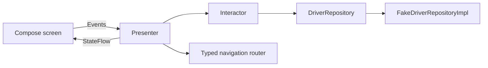
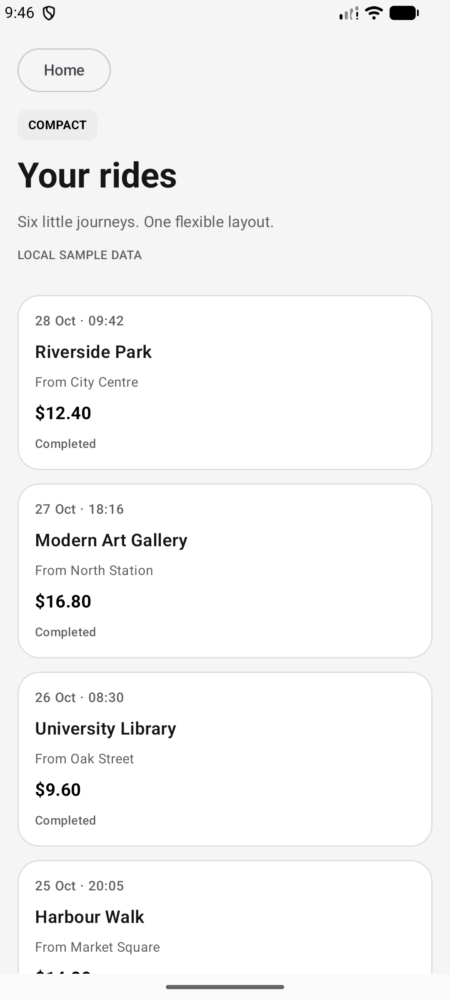
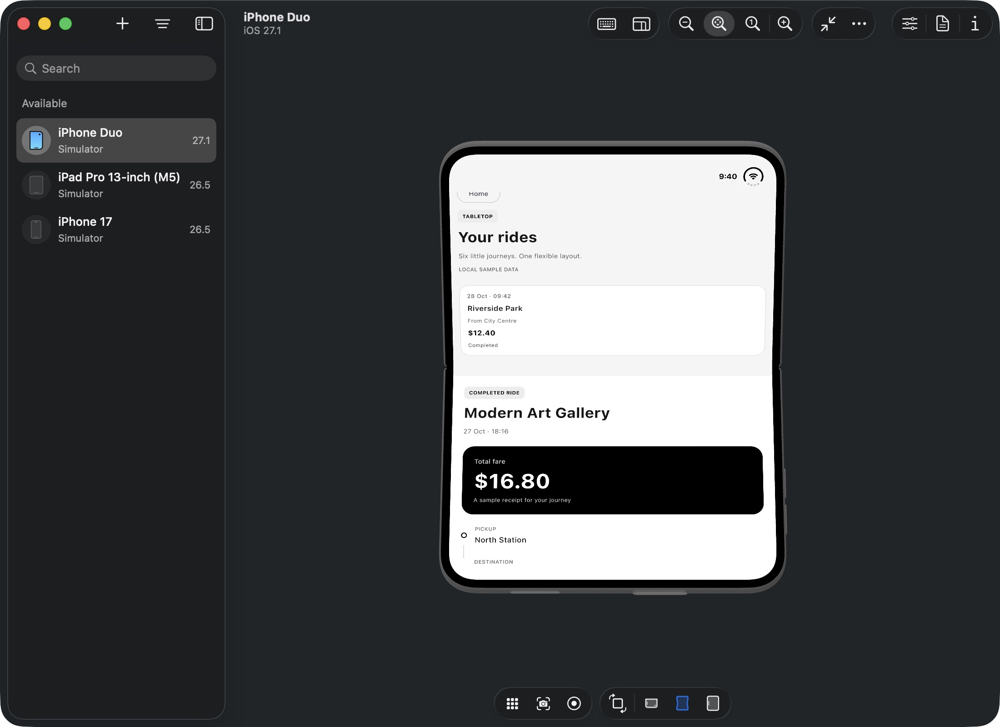

# Mini-Uber

A small Android and iOS app built with Kotlin Multiplatform, Compose Multiplatform, and a VIPER-style architecture. A shared Home screen opens either the original ride-request map experience or a separate adaptive ride-history demo. Screens and business logic are shared, with native Google Maps integration on each platform.

[Original architecture article](https://medium.com/@mahdizareeii/building-a-mini-uber-with-kotlin-multiplatform-viper-architecture-compose-multiplatform-1d3dd0a08399)

The original map flow:

| Map selection | Ride request |
| --- | --- |
|  |  |

## What the demo does

Home offers two independent destinations:

- **Map experience:** move the map and select a pickup point, then a destination, from its center. See a simulated nearby-driver count and a decorative curve, request a ride, and cancel it to return to map selection. Returning Home or using Back does not cancel an active ride; opening the map again resumes it within the same application session.
- **Adaptive demo:** browse six local example rides and their read-only details. Resize, rotate, or fold the device to switch layouts while keeping the selected ride and scroll positions. This demo does not need a Maps key and does not create bookings.

The map's fake repository keeps one active ride in memory. Restarting the application clears it. Driver information is generated locally; there is no backend, GPS integration, address search, road routing, payment processing, or full assigned/arriving/completed trip flow. The adaptive demo's completed rides are separate fixtures, not persisted map bookings. Android and iOS are the configured targets; there is no desktop target.

### Adaptive behavior

The GIFs below show the Android emulator and iPhone Duo simulator with local sample data. Neither demo requires Maps credentials. Android uses captured list/detail frames; iOS uses a simulator screen recording.

| Android adaptive demo | iOS adaptive demo |
| --- | --- |
|  |  |
| Compact layout: ride list → selected details → list. | Select a ride, then fold into tabletop; the selection stays visible. |

- Below **600dp of measured content width**, the list and selected ride detail occupy separate screens. **All rides** and Android Back return from details to the list; Home returns to the landing screen.
- At **600dp and above**, list and detail appear side by side. The list uses 35% of the width, clamped to 240–360dp, with a 24dp gap. With no explicit selection, the first ride appears in the detail pane without changing compact navigation state.
- Active vertical folds split the panes at their reported bounds; horizontal folds use a tabletop layout with the list above the details. These bounds override the width breakpoint. RTL puts the side-by-side list on the right. Headers and navigation controls stay inside their panes, respect safe areas, and scroll in short windows. Occluded regions are excluded from usable pane space. If an occlusion removes a pane entirely, the remaining safe pane uses compact navigation so both the list and details stay reachable.
- Android obtains fold information through Compose Material3 Adaptive 1.3.0. On **iOS 27.1 and later**, a UIKit bridge reads active `UIView.reservedRegions` divisions and occlusions, converts them to window coordinates, and updates the shared layout. Older iOS versions use window-size adaptation and safe areas without fold-region information.

The adaptive screen targets the main app window on Fold/Flip-style devices and iPhone Duo. A dedicated Galaxy Z Flip external cover-screen experience is outside this demo's scope. The map screen retains its original layout and camera interaction.

## How it works



- **View:** shared Compose screens render immutable presenter state and send user events.
- **Presenter:** lifecycle ViewModels manage selection, loading, errors, retry, navigation, and cancellation of obsolete driver searches.
- **Interactor:** feature interfaces expose operations backed by the repository.
- **Entity:** shared models represent locations, drivers, and ride requests. Coordinates are validated before submission.
- **Router:** presenters read typed screen arguments through the router. Koin supplies a router bound to the destination's `SavedStateHandle`; an explicit `resume` argument distinguishes resuming a ride from creating one.

`androidApp` contains the Android application entry point and platform configuration. `composeApp` contains the shared `core`, `data`, `domain`, `feature`, and `component` packages, shared tests, Android Maps Compose adapter, and iOS UIKit bridge. `iosApp` hosts the shared Compose controller in SwiftUI and implements the native Google Maps controller.

`feature.landing` and `feature.adaptive` follow the same structure as `feature.home` and `feature.riderequest`: each Contract, Presenter, State, Event, Action, and Screen has its own file. Screens render state and send events; presenters own navigation through the router. Individual UI components live in each feature's `component` package. The adaptive demo keeps its `DemoRide` model in `model` and its six bundled fixtures in `data`, separate from the fake ride repository. `component.adaptive` contains the shared pane layout, geometry types, and platform contracts in separate files.

Ride Request retains typed argument access inside the presenter:

```kotlin
private val argument = router.getScreenArg<AppScreens.RideRequestScreen>(
    screen = AppScreens.RideRequestScreen::class
)
```

`ScreenRouter` decodes those arguments from the presenter's own back-stack `SavedStateHandle`. They remain bound to that destination even if another screen becomes current. The screen and `App` do not unpack or pass a separate input object. `AppScreens.RideRequestScreen(resume = true)` explicitly resumes the active ride; a new ride requires valid pickup and destination coordinates. Missing coordinates remain absent, and valid zero coordinates are not used as a resume signal.

The map retains continuous camera-position callbacks and the original pickup → destination → request flow. Base-state, coordinate-validation, error/retry, cancellation, and ride-state fixes remain in place. Presenters keep only the latest driver lookup result, and selected points remain available while a recoverable error is shown.

## Toolchain and dependencies

Exact Android/shared dependency versions are maintained in [`gradle/libs.versions.toml`](gradle/libs.versions.toml). The project also pins Gradle through its wrapper and Google Maps through an iOS Swift package resolution file.

| Component | Version |
| --- | --- |
| Android Studio | Rabbit 2 / 2026.2.2 |
| Android Gradle Plugin / Gradle | 9.5.0 / 9.8.2 |
| Kotlin and compiler plugins | 2.4.21 |
| Compose Multiplatform / Material3 | 1.12.2 / 1.9.0 |
| Compose Material3 Adaptive | 1.3.0 |
| JetBrains Lifecycle / Navigation Compose | 2.11.0 / 2.10.0 |
| Koin | 4.2.2 |
| Serialization JSON / Coroutines | 1.12.0 / 1.11.0 |
| AndroidX Activity / Core | 1.13.0 / 1.19.1 |
| Maps Compose / Google Maps iOS | 9.0.1 / 11.2.0 |
| Android compile / minimum / target SDK | 37 / 24 / 36 |
| Xcode / iOS minimum deployment target | 27.1 / 16.6 |

The same catalog supplies Android build identities through `android-namespace`, `android-applicationId`, and `shared-namespace`. Their existing values remain `com.android.miniuber`, `com.android.miniuber`, and `com.shared.miniuber`. Kotlin source packages remain explicit declarations. The iOS bundle identifier stays in [`Config.xcconfig`](iosApp/Configuration/Config.xcconfig), and the exported framework/Swift module remains `ComposeApp`.

Use JDK 21 for Gradle; the build requires JDK 17 or newer and emits JVM 17 bytecode. The shared Android target uses `com.android.kotlin.multiplatform.library`, with Android resources and host tests enabled. The Android application uses AGP's built-in Kotlin support.

The upgrade raises Android's minimum SDK to 24 for Navigation 2.10 and the JVM bytecode target to 17 for Maps Compose 9. These dependency requirements change device/toolchain compatibility; the Android target SDK remains 36.

For iOS, use **Xcode 27.1** and an Apple Silicon Mac. The supported architectures are `iosArm64` and `iosSimulatorArm64`; Intel simulator support was removed. Kotlin's published compatibility table currently lists Xcode 26.4 and does not yet cover this project's latest AGP/Gradle combination. The project targets the newer stable tools, so run the build and IDE sync checks below instead of assuming compatibility from version numbers. See the [Kotlin compatibility matrix](https://kotlinlang.org/docs/multiplatform/multiplatform-compatibility-guide.html) and [Android Studio compatibility guidance](https://developer.android.com/studio/releases).

## Android setup and sync

1. Install Android Studio 2026.2.2, JDK 21, and Android SDK platform 37 through SDK Manager.
2. Open the repository root in Android Studio. Set its Gradle JDK to JDK 21 and use the project's Gradle wrapper.
3. Configure the local Android SDK path in the ignored `local.properties` file if Android Studio has not already done so.
4. Choose **File > Sync Project with Gradle Files**. Add an Android Maps key as described below to use the map experience; Home and the adaptive demo work without it.

For terminal builds on macOS:

```sh
export JAVA_HOME="$(/usr/libexec/java_home -v 21)"
./gradlew help
./gradlew :androidApp:assembleDebug
```

The debug APK is written to `androidApp/build/outputs/apk/debug/androidApp-debug.apk`. Run the `androidApp` configuration on a Google Play-enabled emulator or an Android device to use Google Maps.

### Android Maps key

Supply `MAPS_API_KEY_ANDROID` using one of these sources, in priority order:

1. Environment variable.
2. Gradle project property, including a user-level Gradle properties file or CI configuration.
3. The repository's ignored `local.properties` file.

For local setup, add this entry without changing the existing `sdk.dir` entry:

```properties
MAPS_API_KEY_ANDROID=YOUR_ANDROID_MAPS_API_KEY
```

Enable the Maps SDK for Android for the key and restrict it to the application ID `com.android.miniuber` and the relevant signing certificate. A real key is not required to compile the project; without one, opening the map displays a configuration message with a route back Home. Home and the adaptive demo remain available. Do not commit credentials.

## iOS setup

1. Install Xcode 27.1. Open it to review and accept its license, complete first-launch setup, and install an iOS simulator runtime.
2. Select that Xcode for terminal commands. The example below assumes it is installed as `/Applications/Xcode.app`; adjust the path if needed.
3. For the map experience, copy `iosApp/Configuration/Secrets.example.xcconfig` to `iosApp/Configuration/Secrets.xcconfig`, which is ignored by Git. Set `MAPS_API_KEY_IOS` to an iOS-restricted key with the Maps SDK for iOS enabled. Home and the adaptive demo do not require this step.
4. Open `iosApp/iosApp.xcodeproj`, select the shared `iosApp` scheme and an Apple Silicon simulator, and allow Swift Package Manager to resolve the pinned Google Maps 11.2.0 package.

CI can supply `MAPS_API_KEY_IOS` as an Xcode build setting. The internal `MapsAPIKey` Info.plist entry receives it automatically. An empty key still compiles; Home and the adaptive demo remain available, and opening the map displays a configuration message. No CocoaPods installation is needed.

```sh
export JAVA_HOME="$(/usr/libexec/java_home -v 21)"
export DEVELOPER_DIR=/Applications/Xcode.app/Contents/Developer
xcodebuild -resolvePackageDependencies \
  -project iosApp/iosApp.xcodeproj -scheme iosApp
xcodebuild -project iosApp/iosApp.xcodeproj -scheme iosApp \
  -configuration Debug -sdk iphonesimulator \
  -destination 'generic/platform=iOS Simulator' \
  -derivedDataPath iosApp/build/DerivedData \
  ARCHS=arm64 ONLY_ACTIVE_ARCH=YES CODE_SIGNING_ALLOWED=NO build
```

The Xcode build phase invokes Gradle to build the static `ComposeApp` framework. An unsigned simulator build does not require an Apple development team; physical-device and distribution signing require separate configuration. The simulator app is written under `iosApp/build/DerivedData/Build/Products/Debug-iphonesimulator/`.

## Tests and validation

Run these commands from the repository root. Android host tests include the shared `commonTest` tests:

```sh
./gradlew :composeApp:testAndroidHostTest
./gradlew :androidApp:assembleDebug :androidApp:lintDebug
```

With Xcode 27.1 and its simulator runtime configured:

```sh
./gradlew :composeApp:iosSimulatorArm64Test
./gradlew :composeApp:linkDebugFrameworkIosSimulatorArm64
```

The current shared suite contains **41 tests**: 22 base/map/ride/Landing tests and 19 adaptive tests. Coverage includes coordinate validation, explicit ride resume, missing route arguments, cancellation, presenter action delivery, selection reset, failed requests, stale map results, Landing navigation, and returning Home without cancellation. Adaptive tests cover the 599/600dp boundary, pane sizing, RTL, thin folds, tabletop layout, window-coordinate conversion, occlusion avoidance, fallback when a pane is fully occluded, selection across layout changes, and presenter-driven Home navigation. The iOS suite runs these tests plus two real `SavedStateHandle` decoding tests for destination isolation and missing coordinates, for **43 tests** in total. A successful `help` task checks Gradle configuration; it does not replace Android Studio sync or an application smoke test.

On both platforms, verify Home → each destination → Home, map movement, pickup and destination selection, ride submission, cancellation, active-ride resumption after returning Home, and loading/error/retry behavior. Verify the adaptive demo at compact and wide widths, in landscape, tabletop and vertical-fold postures, RTL, and large font sizes. Check both list and detail scroll positions across resizing, and launch Home/adaptive without Maps credentials. Runtime Maps verification requires working credentials and network access.

### Dependency-upgrade baseline — 2026-10-28

This historical record predates the new Home/adaptive screens and restoration of continuous map callbacks. It establishes the upgrade baseline, not validation of the current adaptive changes.

- Gradle `help` passed. A real Android Studio 2026.2.2 project sync completed with `BUILD SUCCESSFUL`.
- All **15 shared Android host tests passed**: test report (local: `composeApp/build/reports/tests/testAndroidHostTest/index.html`).
- After launcher-icon cleanup, the final clean Android debug assembly and lint run passed in 57 seconds with normal caching enabled: debug APK (local: `androidApp/build/outputs/apk/debug/androidApp-debug.apk`), lint report (local: `androidApp/build/reports/lint-results-debug.html`). Lint reported zero errors and two `OldTargetApi` warnings because target SDK 36 is intentionally retained.
- Xcode 27.1 resolved the exact Google Maps 11.2.0 [Swift package pin](iosApp/iosApp.xcodeproj/project.xcworkspace/xcshareddata/swiftpm/Package.resolved), linked the shared framework (local: `composeApp/build/bin/iosSimulatorArm64/debugFramework/ComposeApp.framework/`), and built the complete unsigned simulator app (local: `iosApp/build/DerivedData/Build/Products/Debug-iphonesimulator/MiniUber.app/`).
- All **15 iOS simulator tests passed** using the installed iOS 26.5 simulator runtime with SDK 27.1: test report (local: `composeApp/build/reports/tests/iosSimulatorArm64Test/index.html`).
- The interactive iOS pickup → destination → request → cancel smoke test passed on the iOS 27.1 DeviceHub runtime. Selection markers were visible, but map tiles remained blank.
- The interactive Android pickup → destination → request → cancel smoke test passed on the API 37.1 emulator, returning to the ready pickup screen after cancellation.

Android map tiles remain blocked by an authorization failure for the existing Maps key. In those smoke checks, the ride flow worked with simulated data on both platforms; map-tile rendering was not verified successfully on either platform. Configure authorized, platform-restricted Google Maps keys before recording a live map demo. Build artifacts and test reports above are local generated outputs.

### Home, adaptive, and router validation — 2026-10-28

- All **41 Android host tests passed**, including 22 base/map/ride/Landing tests and 19 adaptive tests. Local test report: `composeApp/build/reports/tests/testAndroidHostTest/index.html`.
- Android debug assembly passed: debug APK (local: `androidApp/build/outputs/apk/debug/androidApp-debug.apk`). Android lint reported **zero errors** and two intentional `OldTargetApi` warnings for target SDK 36: lint report (local: `androidApp/build/reports/lint-results-debug.html`).
- A real Android Studio 2026.2.2 project sync passed.
- All **43 iOS simulator tests passed**: the 41 shared tests plus two real `SavedStateHandle` argument-decoding tests. Local test report: `composeApp/build/reports/tests/iosSimulatorArm64Test/index.html`.
- The shared iOS framework and complete unsigned simulator application built successfully with Xcode 27.1: framework (local: `composeApp/build/bin/iosSimulatorArm64/debugFramework/ComposeApp.framework/`), simulator app (local: `iosApp/build/DerivedData/Build/Products/Debug-iphonesimulator/MiniUber.app/`).

Interactive checks completed:

- **Android:** compact ride list and detail selection; Home → Map → Home → Adaptive navigation. The final compact screenshot includes dark status-bar icons.
- **iPhone Duo simulator:** Open posture displayed two panes. Ride 2 remained selected through Partially Open vertical side-by-side layout, rotation into tabletop layout, and Closed compact details. All rides → list → Home and Home → Map → Home also worked.
- After the feature-file and router refactor, the rebuilt iOS application passed Home → Adaptive → ride details → Home and Home → Map → Home again.
- These navigation checks used builds without Maps keys. They verified the unavailable-map screen and return navigation; they did not verify live map tiles.

| Android compact | iPhone Duo tabletop |
| --- | --- |
|  |  |

Native Android Fold/Flip visual checks, large-font visual checks, and RTL visual checks remain incomplete in this validation record. Shared policy tests cover fold bounds, RTL placement, geometry conversion, and occlusions, but do not replace those device-level checks. The historical Maps authorization failure still needs a working key before recording a live map demo.

iOS linking still reports the existing ICU dependency warning: it was built for iOS 18.5 while this project's deployment target is 16.6. The framework and application builds passed; an actual iOS 16.6 runtime has not been validated.

## Roadmap

1. Display nearby-driver markers and complete the simulated ride-status flow.
2. Add current-location/recenter and address search.
3. Add road routes, distance, ETA, and fare estimates.
4. Add persistent ride history, then backend integration, authentication, and live tracking.
