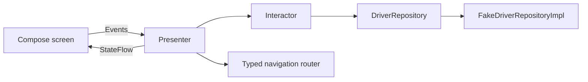

[Read the architecture article on Medium](https://medium.com/@mahdizareeii/building-a-mini-uber-with-kotlin-multiplatform-viper-architecture-compose-multiplatform-1d3dd0a08399)

# Mini-Uber — Adaptive Compose Multiplatform with VIPER-Inspired Architecture

| Original map experience | Adaptive Compose demo |
| :---: | :---: |
| **Map selection · Android and iOS**  | **Android · Pixel Fold**  |
| **Ride request · Android and iOS**  | **iOS · iPhone Duo in Device Hub**  |

Select any preview to view it at full size.

Mini-Uber shares UI and presentation logic across Android and iOS with **Kotlin Multiplatform**, **Compose Multiplatform**, and **VIPER-inspired architecture**. Home opens the original map demo or a separate adaptive ride-history demo with local sample data. Immutable **StateFlow** state drives the UI; the adaptive layout responds to available space and native fold information while preserving selection and scroll positions.

## Architecture flow

Screens send events to presenters. Presenters publish immutable state back to the UI, use interactors for data operations, and delegate typed navigation to routers.
