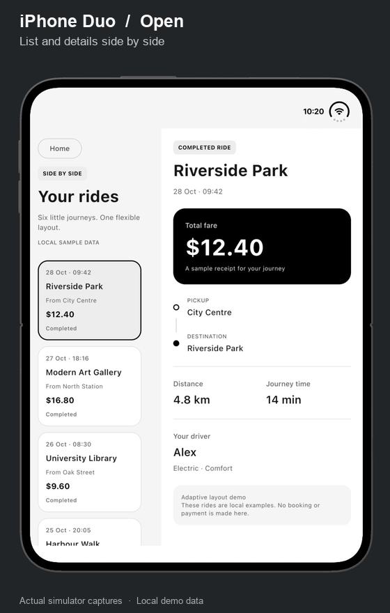
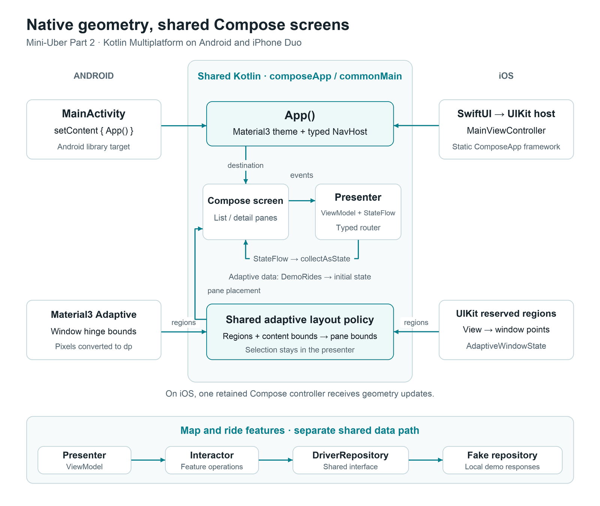
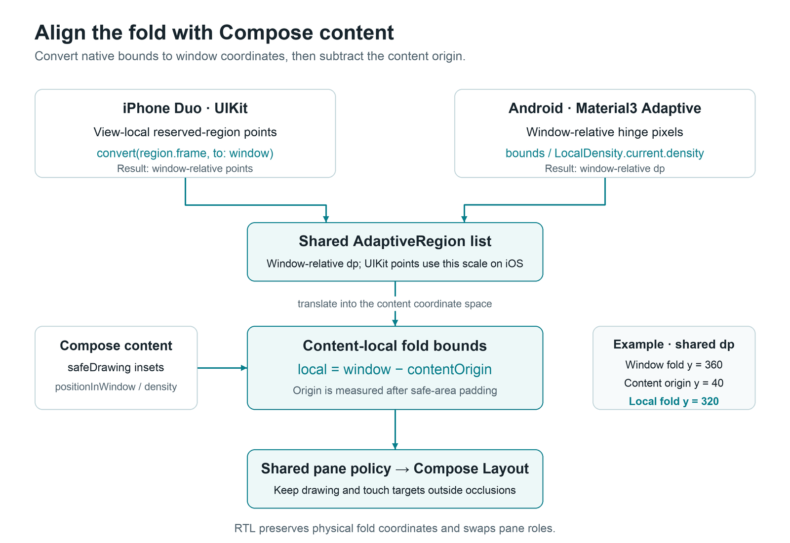

# Mini-Uber Part 2: Building an Adaptive iPhone Duo UI with Compose Multiplatform

*Connecting UIKit reserved regions to shared Kotlin layout logic while preserving selection, scrolling, and navigation intent.*

In [Part 1](https://medium.com/@mahdizareeii/building-a-mini-uber-with-kotlin-multiplatform-viper-architecture-compose-multiplatform-1d3dd0a08399), I built Mini-Uber with Kotlin Multiplatform, Compose Multiplatform, and a VIPER-inspired architecture. Compose screens observed presenter state, interactors exposed ride operations, and a router handled navigation.

For Part 2, I wanted to explore what happens when the available screen space changes while someone is using the app.

On iPhone Duo, opening, closing, rotating, or partially folding the device can change both the available space and the regions that content needs to avoid. A selected ride should remain selected while its presentation changes from one pane to two.

I added a separate, read-only adaptive demo to Mini-Uber. It uses six bundled sample rides, so I can explore layout behavior independently of Maps credentials and ride requests.



*The recording shows the iPhone Duo simulator rotating, opening, entering a partially open book posture, and closing with Harbour Walk still selected.*

## Keeping the shared architecture

The application still has the same basic responsibilities:

- **View:** a Compose screen that renders state and sends events.
- **Presenter:** a lifecycle ViewModel that owns feature state and handles events.
- **Interactor:** operations used by the map and ride-request features.
- **Entity:** shared Kotlin models.
- **Router:** typed navigation and destination arguments.

The adaptive feature fits into the presentation layer. Its state contains local demo rides and the selected ride ID; it does not call the ride repository.



*Native hosts and geometry adapters feed a shared Compose presentation layer. The map feature retains its interactor and repository path.*

KMP compiles the shared Kotlin code for each target. Android consumes the Android library target; iOS receives a static `ComposeApp` framework built with Kotlin/Native. A SwiftUI wrapper creates a UIKit host, which embeds the shared Compose controller.

The platform-specific boundary supplies native geometry. The shared layer decides where the list and details belong. The same feature presenter and Compose components remain in use on both platforms.

## State ownership before layout

I first tightened the base state contract. Each presenter creates its flows once and exposes read-only views:

```kotlin
protected val _state = MutableStateFlow(UiState(initialState))
override val state = _state.asStateFlow()

protected val _action = MutableSharedFlow<UI_ACTION>()
override val action = _action.asSharedFlow()
```

The state wrapper keeps content, loading, and errors together:

```kotlin
data class UiState<T>(
    val data: T,
    val isLoading: Boolean = false,
    val error: String? = null,
)
```

This lets a presenter update loading or error information while retaining its existing content. Screens observe `presenter.state.collectAsState()` and send typed events to `onEvent`.

For example, the adaptive presenter validates a ride ID and publishes a copied state:

```kotlin
private fun selectRide(id: String) {
    _state.update { state ->
        if (state.data.rides.none { it.id == id }) {
            state
        } else {
            state.copy(data = state.data.copy(selectedRideId = id))
        }
    }
}
```

`update` operates on the current value atomically. Copying the feature data leaves previously published snapshots intact. StateFlow holds the latest state and suppresses equal values, which is appropriate for rendering the current screen.

There was also a correction to the action contract from Part 1: a getter that constructs `MutableSharedFlow()` creates a different stream on each access. Keeping it in a `val` gives collectors and emitters the same instance. The current features navigate through the router directly; this action flow is available infrastructure, with no replay or extra buffer by default. It does not provide durable or exactly-once event delivery. [SharedFlow documentation](https://kotlinlang.org/api/kotlinx.coroutines/kotlinx-coroutines-core/kotlinx.coroutines.flow/-shared-flow/).

## Reading iPhone Duo geometry with UIKit

Apple describes regions that can divide or cover parts of the display. The folding area and camera regions can become active as the device's configuration changes. Custom layouts can respond through `ReservedRegion`. [Designing for iPhone Duo](https://developer.apple.com/design/human-interface-guidelines/designing-for-iphone-duo).

I represent those regions with a small shared model:

```kotlin
data class AdaptiveRegion(
    val left: Float,
    val top: Float,
    val right: Float,
    val bottom: Float,
    val kind: AdaptiveRegionKind
)

enum class AdaptiveRegionKind {
    DIVISION,
    OCCLUSION
}
```

The Swift host retains one `AdaptiveWindowState` and one Compose controller. Inside its custom `UIView`, it reads active regions during `updateConstraints()`:

```swift
override func updateConstraints() {
    var regions: [AdaptiveRegion] = []
    if #available(iOS 27.1, *), let window {
        for region in reservedRegions(kind: .division) where region.isActive {
            regions.append(sharedRegion(
                frame: convert(region.frame, to: window),
                kind: .division
            ))
        }
        for region in reservedRegions(kind: .occlusion) where region.isActive {
            regions.append(sharedRegion(
                frame: convert(region.frame, to: window),
                kind: .occlusion
            ))
        }
    }
    onRegionsChanged?(regions)
    super.updateConstraints()
}
```

*From `AdaptiveHostViewController.swift`. The `sharedRegion` helper converts a `CGRect` into the shared Kotlin model.*

UIKit observes reserved-region reads in this constraint-update path. The host also requests constraint updates when its window frame or safe-area insets change. The availability guard lets earlier supported iOS versions continue using size-based layouts and safe areas. [UIView.ReservedRegion](https://developer.apple.com/documentation/uikit/uiview/reservedregion).

`AdaptiveWindowState` filters invalid rectangles and publishes the list through `mutableStateOf`. The Kotlin `MainViewController` supplies that object through `LocalAdaptiveWindowState`. The iOS implementation of the shared region reader is then small:

```kotlin
@Composable
actual fun currentAdaptiveRegions(): List<AdaptiveRegion> =
    LocalAdaptiveWindowState.current.regions
```

On Android, the equivalent implementation reads Material3 Adaptive hinge information and converts its pixel bounds by display density. Both platforms produce the same shared region model.

Layout changes update this observable geometry while the existing Compose controller stays alive. That preserves the composition and its navigation owner through changes to the native window.

## Putting the coordinates in the same space

The coordinate conversion was one of the most important details in this implementation.

UIKit provides a region relative to its view. The shared layout works with the Compose content area, which may be offset by safe areas or navigation insets. Using those coordinates directly can shift the apparent fold away from its physical location.

I use this pipeline:



*UIKit points are converted to window coordinates. Android window pixels are converted to dp. The shared policy then subtracts the Compose content's window origin.*

On iOS, Swift calls `convert(region.frame, to: window)`. UIKit points correspond to Compose dp in this integration.

The Compose screen applies `WindowInsets.safeDrawing` and measures its position in the window. Its pixel position is divided by the Compose density to obtain the content origin in dp:

```kotlin
.onGloballyPositioned { coordinates ->
    val position = coordinates.positionInWindow()
    origin = Offset(
        x = position.x / density.density,
        y = position.y / density.density
    )
}
```

The layout policy translates every valid region into the content's local coordinate space:

```kotlin
val left = region.left - originX
val right = region.right - originX
val top = region.top - originY
val bottom = region.bottom - originY
```

For example, a horizontal region starting at window y = 360dp belongs at local y = 320dp when the content begins 40dp below the window's origin. The policy then clips the translated region to the content bounds.

Keeping this transformation in shared code makes it possible to test independently of UIKit and Compose rendering.

## Choosing and placing the panes

The layout policy takes measured content width and height, window-relative regions, the Compose content origin, layout direction, and whether the user has selected a ride.

A reserved region that spans the content can act as a divider:

- A vertical division places the list and details on opposite sides.
- A horizontal division places the list above the details.
- Occlusions reduce the usable pane rectangles. If one pane becomes unusable, the remaining safe pane uses compact navigation.

Without a spanning divider, the policy uses a **600dp content-width breakpoint**. Below it, the screen shows either the list or the selected detail. At or above it, it shows both. The list receives 35% of the width, constrained to 240–360dp, with a 24dp gap.

These numbers are this demo's layout policy. They are not a mapping of UIKit compact and regular size classes.

RTL changes which pane contains the list while retaining the physical region coordinates. When rendering, the custom Compose `Layout` measures each pane to its assigned rectangle, rounds pixel bounds inward, and clips its children. This keeps drawing and touch targets inside the calculated safe area.

## Keeping selection and scrolling stable

A wide layout needs something useful in its detail pane before the user selects a ride. I show the first ride as a derived preview:

```kotlin
fun effectiveSelectedRide(isTwoPane: Boolean): DemoRide? {
    val selectedRide = rides.firstOrNull { it.id == selectedRideId }
    return selectedRide ?: if (isTwoPane) rides.firstOrNull() else null
}
```

The key is that this function does not write `selectedRideId`. A default wide-screen preview therefore does not create a user selection. If the device closes before an explicit selection, the compact layout still opens on the list. After an explicit selection, it shows that ride's details.

Scroll ownership follows the same principle. The screen creates its scroll states before rendering either pane:

```kotlin
val listScrollState = rememberLazyListState()
val detailScrollStates = rememberSaveable(saver = RideScrollStatesSaver) {
    mutableMapOf<String, ScrollState>()
}
```

The list keeps its `LazyListState`, and each ride's details retrieve a `ScrollState` by ride ID. The custom saver stores integer scroll offsets. Rearranging the panes therefore reuses their scroll owners rather than creating a fresh position inside each layout branch.

Selection belongs to the destination's ViewModel; it is not explicitly saved for process-death restoration. Retention during folding follows the lifetime of that destination and its retained Compose host.

Navigation also remains separate from pane placement. `NavHost` wraps the feature; the pane layout only arranges content. The compact "All rides" action clears the explicit selection. Returning Home uses the router.

## Validation and the remaining iOS work

I kept the layout policy as a pure Kotlin function so its behavior can be tested with ordinary inputs. The adaptive tests cover the 599/600dp boundary, pane sizing, thin folds, horizontal and vertical divisions, window-origin offsets, RTL, occlusion fallback, and selection behavior.

I also exercised the app in iPhone Duo Device Hub. The recording above shows rotation, an open inner display, a partially open book posture, and closing onto the selected ride. It does not demonstrate the horizontal/tabletop arrangement; that geometry has separate policy-test coverage.

Apple's guidance also applies to navigation and the rest of the app. The next work is to adapt global navigation controls to Duo's side placement where appropriate, extend reserved-region handling beyond the adaptive demo, and give Ride Request a usable short-window scrolling fallback. Native Split View sizes and active-camera/Dynamic Island changes also need interactive validation. [iPhone Duo design guidance](https://developer.apple.com/design/human-interface-guidelines/designing-for-iphone-duo).

The part I found most useful was giving each concern a clear owner: native code reports the available geometry, shared Kotlin calculates the pane bounds, and the presenter keeps the user's selection. That makes layout changes easier to reason about without coupling user intent to a particular window shape.

The implementation is available in [Mini-Uber on GitHub](https://github.com/mahdizareeii/Mini-Uber). Start with [`AdaptiveHostViewController.swift`](https://github.com/mahdizareeii/Mini-Uber/blob/main/iosApp/iosApp/AdaptiveHostViewController.swift), [`AdaptiveLayoutPolicy.kt`](https://github.com/mahdizareeii/Mini-Uber/blob/main/composeApp/src/commonMain/kotlin/com/shared/miniuber/component/adaptive/AdaptiveLayoutPolicy.kt), and [`AdaptiveDemoScreen.kt`](https://github.com/mahdizareeii/Mini-Uber/blob/main/composeApp/src/commonMain/kotlin/com/shared/miniuber/feature/adaptive/AdaptiveDemoScreen.kt).
